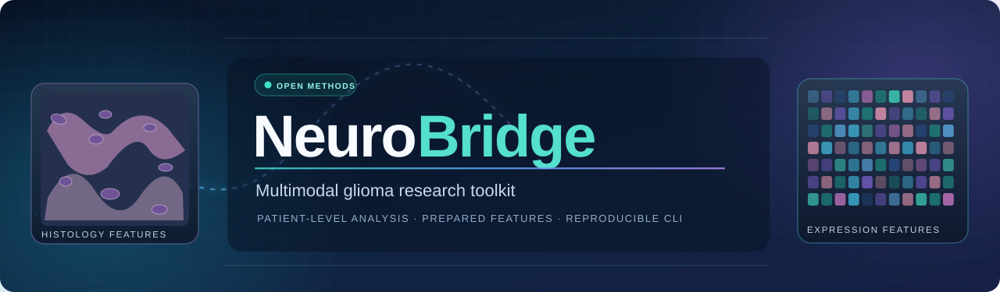
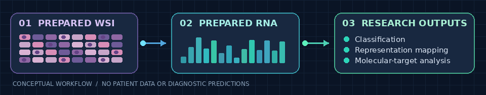

<div align="center">
  

  <p><strong>Open research methods for patient-level histopathology × gene-expression analysis.</strong></p>
  <p>Reproducible CLI · Missing-modality research · Molecular target modeling</p>

  [](pyproject.toml)
  [](LICENSE)
  [](#what-is-included)
  [](#scientific-scope-and-limitations)

  [](#quick-start)
  [](#reproduce-the-pca-2-manuscript-setting)
  [](#commands-at-a-glance)
  [](#documentation)
  [](#citation-and-license)
  [](https://github.com/HazratMaghaz/NeuroBridge/issues)
</div>

> [!IMPORTANT]
> **NeuroBridge is retrospective research software, not a diagnostic application.** It studies *TCGA-GBM versus TCGA-LGG project-group separation* using **already prepared, patient-matched features**. It does not infer a clinical diagnosis from a raw slide or sequencing file.

## At a glance

NeuroBridge provides a small command-line interface around corrected research analysis scripts. The public repository is intentionally **source-only**: no patient records, raw whole-slide images, trained weights, or historical predictions are distributed.

<div align="center">
  
  <p><sub>Conceptual workflow animation; not patient data or a model-output visualization.</sub></p>
</div>

| Start here if you want to… | Recommended path |
| :--- | :--- |
| **See it run without real data** | [Install → run the synthetic demo](#quick-start) |
| **Check prepared TCGA-compatible inputs** | [Validate your study](#use-your-prepared-data) |
| **Replicate the revised paper setting** | [PCA-2 configuration](#reproduce-the-pca-2-manuscript-setting) |
| **Examine the analysis stages** | [CLI command reference](#commands-at-a-glance) |
| **Understand what results can and cannot show** | [Scientific caveats](#scientific-scope-and-limitations) |

## Quick start

**Requirements:** Linux, Python **3.11+**, Conda, and a terminal. The synthetic demo does **not** need TCGA files.

```bash
# 1. Clone the source code.
git clone https://github.com/HazratMaghaz/NeuroBridge.git
cd NeuroBridge

# 2. Create a clean environment.
conda create -n neurobridge python=3.11 -y
conda activate neurobridge

# 3. Install the CLI and CPU-only PyTorch.
bash setup_cpu.sh

# 4. Check the commands and run the synthetic smoke test.
neurobridge --help
neurobridge demo
```

**Expected outcome:** a message ending with `SYNTHETIC SMOKE TEST PASSED`. This only verifies that the software runs on deliberately generated toy data—it **does not reproduce any manuscript accuracy**.

<details>
<summary><strong>Already have PyTorch or want a CUDA-enabled environment?</strong></summary>

The CLI can be installed without a heavyweight GPU framework:

```bash
python -m pip install -e .
neurobridge --help
```

Input validation can run without PyTorch. Model execution needs a compatible PyTorch installation. For GPU use, install the correct build with the [official PyTorch selector](https://pytorch.org/get-started/locally/) before running the modeling stage. Installing `requirements-full.txt` may pull substantial CUDA libraries on Linux. The `setup_cpu.sh` script is for CPU-only environments.

</details>

## Use your prepared data

The real-data workflow begins with **prepared patient-level features**, not raw WSI or FASTQ files. An approved study directory must contain the expression matrix, split manifest, and feature embeddings in the layouts described in the [reproducibility guide](docs/REPRODUCIBILITY.md).

```bash
# Historical/general example (PCA-128); not the revised manuscript setting.
cp configs/example.yaml my-study.yaml

# Edit 'project' and 'split_csv' for your own prepared dataset.
neurobridge validate --config my-study.yaml --stage classification
neurobridge run --config my-study.yaml --stage classification
```

`validate` checks required paths, patient/split consistency, and expected feature dimensions before modeling. The underlying analysis performs further numerical checks. Each new run needs a **unique `run_id`**.

## Reproduce the PCA-2 manuscript setting

The **revised manuscript** uses **two principal components** for its direct molecular PCA representation. The generic `configs/example.yaml` intentionally preserves the older **128-component** setting (`pca_dim: 128`) for historical traceability.

```bash
# Copy the manuscript-specific example.
cp configs/manuscript_pca2.yaml my-pca2-study.yaml

# Edit the private local copy: 'project', 'split_csv', and 'device'.
# The provided template sets pca_dim: 2.
neurobridge validate --config my-pca2-study.yaml --stage classification
neurobridge run --config my-pca2-study.yaml --stage classification
```

Read [PCA-2 manuscript reproducibility and limitations](docs/PCA2_MANUSCRIPT_REPRODUCIBILITY.md) for parameters, cohort definitions, reported results, and the distinction between retrospective evaluation and independent validation.

> [!NOTE]
> The corrected classification scripts can retain a **legacy output identifier** such as `molecular_pca128` even when configured for PCA-2. Confirm the recorded `pca_dim` in the run manifest before interpreting or relabeling an output. **Do not silently rewrite historical results.**

## Commands at a glance

| Command | Purpose | What it requires |
| :--- | :--- | :--- |
| `neurobridge --help` | Show the CLI and options | Installed CLI |
| `neurobridge demo` | Run a short **synthetic** CPU smoke test | CPU PyTorch; no study files |
| `neurobridge validate --config FILE --stage classification` | Check prepared input contract | Prepared features and manifest |
| `neurobridge run --config FILE --stage classification` | Corrected patient-level classification and representation mapping | Prepared features; PyTorch |
| `neurobridge run --config FILE --stage core` | Classification **then** molecular-target analysis | Classification inputs plus biology requirements |
| `neurobridge run --config FILE --stage external` | **Verify/repackage historical** external outputs | Previously produced CPTAC/Gene2Morph result files |
| `neurobridge run --config FILE --stage full` | Run core analyses and historical external reporting | **All** relevant prepared inputs and historical outputs |

Outputs are saved under:

```text
PROJECT/
└── results/
    └── corrected_v3/
        └── RUN_ID/
```

**The `external` stage does not refit or independently regenerate CPTAC or Gene2Morph predictions.** For complete command details and prerequisites, see [docs/REPRODUCIBILITY.md](docs/REPRODUCIBILITY.md).

## What is included

```text
NeuroBridge/
├── neurobridge/            # CLI: demo, validate, run
├── analysis/
│   ├── scripts/            # Corrected research analysis code
│   ├── tests/              # Scientific invariant tests + toy-data generator
│   └── run.sh              # Historical staged wrapper
├── configs/
│   ├── example.yaml        # Historical PCA-128 example
│   └── manuscript_pca2.yaml  # Revised PCA-2 paper example
├── docs/                   # Reproducibility and scientific limitations
├── tests/                  # CLI and preflight tests
├── assets/                 # README illustrations (no research figures)
├── pyproject.toml          # CLI package definition
├── setup_cpu.sh            # CPU installation helper
├── CITATION.cff            # Citation metadata
├── THIRD_PARTY_NOTICES.md  # Third-party attribution and boundaries
├── SECURITY.md
└── LICENSE
```

**Not included:** TCGA/CPTAC patient data, raw histology slides, RNA sequencing files, feature matrices, trained weights, or patient-level predictions. Users must obtain data lawfully and prepare inputs according to the documented schema.

## Scientific scope and limitations

- **Task definition.** The classification labels encode **TCGA-GBM versus TCGA-LGG project membership**. These are retrospective cohort groups, not independently validated individual diagnoses.
- **Study configuration.** The canonical matched cohort contained **686 patients**. The development portion comprised **583 patients**, with a previously examined **103-patient fixed-test group**. These patients and results are **not distributed** in this repository.
- **Model-selection history.** PCA-2 was investigated after the earlier PCA-128 analysis. The paper's PCA-2 results and fixed-test comparisons must be understood as **retrospective**, not untouched prospective confirmation.
- **Source-site confounding.** The development cohort's **33 tissue-source sites did not overlap across GBM and LGG groups**. A held-out-site sensitivity analysis does not remove this limitation.
- **External validity.** The available historical CPTAC-GBM work does **not** establish independent GBM-versus-LGG binary classification generalization. Additional appropriately matched external cohorts are needed.

For reported numerical results, analysis configuration, and interpretation, use the [manuscript reproducibility document](docs/PCA2_MANUSCRIPT_REPRODUCIBILITY.md) instead of the synthetic demo output.

## Documentation

| Resource | Use it for |
| :--- | :--- |
| [Reproducibility guide](docs/REPRODUCIBILITY.md) | Input contract, stages, outputs, and run prerequisites |
| [PCA-2 manuscript protocol](docs/PCA2_MANUSCRIPT_REPRODUCIBILITY.md) | The revised analysis setting and its limitations |
| [Example configuration](configs/example.yaml) | Historical PCA-128 example |
| [PCA-2 configuration](configs/manuscript_pca2.yaml) | Revised paper's PCA setting |
| [Security policy](SECURITY.md) | Responsible reporting of security concerns |
| [Third-party notices](THIRD_PARTY_NOTICES.md) | Dependency/attribution information |

<details>
<summary><strong>For advanced users: run checks and understand provenance</strong></summary>

```bash
# Run the two existing local test suites.
python -m unittest discover -s analysis/tests -p 'test_*.py' -v
python -m unittest discover -s tests -p 'test_*.py' -v

# Read the stage-level design.
cat docs/REPRODUCIBILITY.md
```

`ci/neurobridge-ci.yml` is a **CI workflow template**, not an active GitHub Actions workflow. Do not assume that GitHub checks are running merely because the YAML file is present. The research repository deliberately separates synthetic software testing from claims about real-data evaluation.

</details>

<details>
<summary><strong>FAQ: Can I pass an SVS slide or FASTQ directly?</strong></summary>

**No.** This release starts from precomputed, matched patient-level representations. Raw WSI processing, raw RNA sequencing preprocessing, and download orchestration are not packaged as an end-to-end public pipeline.

</details>

<details>
<summary><strong>FAQ: Can I reproduce every figure with the demo?</strong></summary>

**No.** `neurobridge demo` is a synthetic smoke test. The original manuscript figures require appropriately prepared research data; some historical molecular and external analyses also require files that are not distributed here.

</details>

## Citation and license

If this repository helps your work, use GitHub's **Cite this repository** control or see [`CITATION.cff`](CITATION.cff). Cite the associated manuscript separately when publication details are available; **no paper DOI is asserted here**.

The source code is distributed under the [MIT license](LICENSE), subject to the separate rights of third-party datasets, models, and resources described in [THIRD_PARTY_NOTICES.md](THIRD_PARTY_NOTICES.md). This license does **not** grant redistribution rights for TCGA/CPTAC data or third-party pretrained weights.

<div align="center">
  <sub>NeuroBridge • Transparent research methods, reproducible software checks, and explicit scientific boundaries.</sub>
</div>
